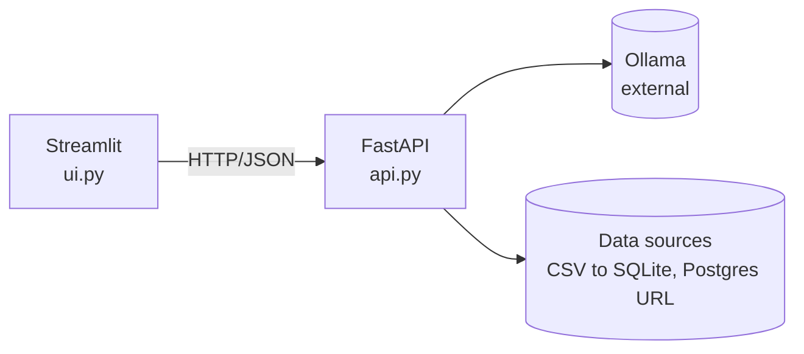
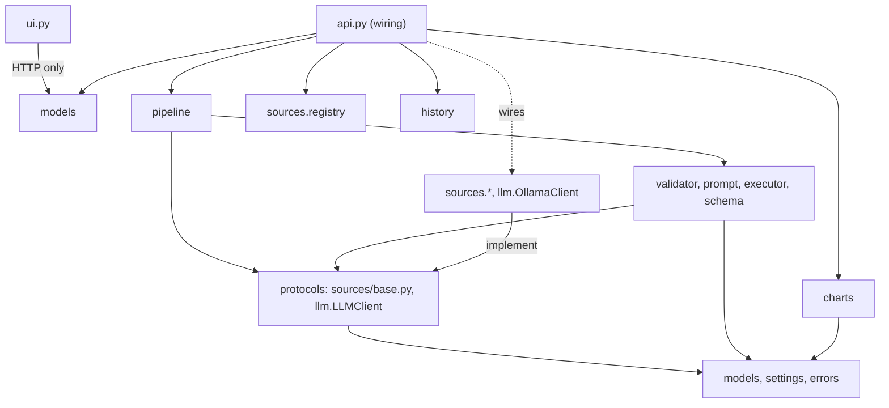
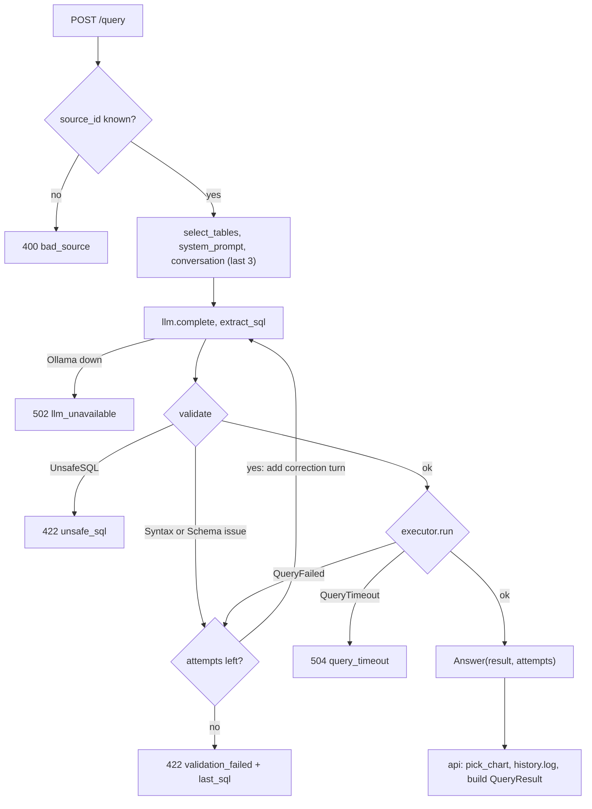

# SQLWhisper — Architecture

Version 0.2. Companion to `PRD.md`. Decisions and reasons live in `DECISION.md`.

Describes the code as built through X1-6. Items marked _(X1-n)_ are not built yet.

---

## 1. System view



Two processes (`api`, `ui`), one image, one Python package. Ollama is external (host, LAN, or another compose project).

## 2. Layering and dependency rule

Imports point downward only. A lower layer never imports a higher one.



`pipeline` knows protocols, never `OllamaClient`, `CsvSource` or `PostgresSource`. Wiring happens once, in `api.py`.

## 3. Modules

| Module                | Responsibility                                                                     | State?       |
| --------------------- | ---------------------------------------------------------------------------------- | ------------ |
| `settings.py`         | Env → typed settings                                                               | none         |
| `models.py`           | Pydantic request/response models, `Schema`, `ResultSet`                            | none         |
| `errors.py`           | Domain exceptions (see §7)                                                         | none         |
| `sources/base.py`     | `DataSource` protocol                                                              | none         |
| `sources/csv.py`      | CSV → SQLite file, normalise columns, read-only engine                             | file on disk |
| `sources/postgres.py` | Postgres engine, read-only transaction, label without password                     | engine       |
| `sources/registry.py` | `source_id → DataSource`                                                           | in memory    |
| `schema.py`           | Introspect, keyword table selector                                                 | none         |
| `llm.py`              | `LLMClient` protocol, `OllamaClient` (httpx, `health()`)                           | none         |
| `prompt.py`           | Build system prompt, chat turns, correction turn; extract SQL from the reply       | none         |
| `validator.py`        | sqlglot parse → safety → schema check                                              | none         |
| `executor.py`         | Enforce LIMIT on AST (max_rows + 1), run on the source's read-only engine, timeout | none         |
| `charts.py`           | Result shape → chart spec                                                          | none         |
| `pipeline.py`         | generate → validate → execute, retry on fixable errors                             | none         |
| `history.py`          | SQLite log of queries                                                              | file on disk |
| `api.py`              | FastAPI routes, error mapping, wiring                                              | app state    |
| `ui.py`               | Streamlit rendering, Plotly figure from chart spec                                 | session      |

KISS rule: plain functions where there is no state. Classes only for adapters and anything holding state.

## 4. Contracts

```python
class LLMClient(Protocol):
    def complete(self, system: str, messages: list[Message]) -> str: ...


class DataSource(Protocol):
    id: str
    label: str  # safe to display and log
    dialect: Literal["sqlite", "postgres"]

    def engine(self) -> Engine: ...  # read-only engine
    def schema(self) -> Schema: ...  # cached


def validate(
    sql: str, schema: Schema, dialect: Dialect
) -> ValidatedSQL: ...  # raises SyntaxIssue | UnsafeSQL | SchemaIssue


def run(
    source: DataSource, query: ValidatedSQL, *, max_rows: int, timeout_s: float
) -> ResultSet: ...


def pick_chart(result: ResultSet) -> ChartSpec | None: ...


def answer(
    question: str, context: list[QA], source: DataSource, llm: LLMClient, cfg: PipelineConfig
) -> Answer: ...  # Answer(result: ResultSet, attempts: int)
```

All sync. FastAPI endpoints are plain `def`, so they run in a threadpool. No async machinery.

## 5. Request flow: `POST /query`



Attempts: `1 + MAX_RETRIES`. Validation runs against the selected table subset. Chart, history and `QueryResult` are built in `api.py`. History logs question, SQL, row count and source label, also with `ok=false` when the pipeline raises. It never stores credentials. A failed history write is logged (exception type only) and never changes the response ([D-33](DECISION.md)). The executor makes values JSON-safe (`plain_value`): Decimal to int/float, NaN/inf to null, bytes to a placeholder.

## 6. Safety model (defense in depth)

| Layer | Mechanism                                                                                                                                                                                       | Protects against           |
| ----- | ----------------------------------------------------------------------------------------------------------------------------------------------------------------------------------------------- | -------------------------- |
| 1     | Prompt rules: single SELECT, exact columns                                                                                                                                                      | Most bad output (soft)     |
| 2     | Validator: AST root must be a query (SELECT/CTE/UNION); write, DDL, INTO, COPY, FOR UPDATE, PRAGMA or SET node anywhere → block; unparseable text starting with a write keyword is also blocked | Model emits writes         |
| 3     | Read-only connection: SQLite `mode=ro`, PG `default_transaction_read_only=on`                                                                                                                   | Validator bug              |
| 4     | LIMIT enforced on AST (default 500)                                                                                                                                                             | Huge result sets           |
| 5     | Statement timeout (default 15 s)                                                                                                                                                                | Runaway queries            |
| 6     | Schema-only prompts: no row data ever sent to the LLM                                                                                                                                           | Prompt injection via cells |

Layers 2 and 3 are independent: either one alone stops a write. Read-only is set up by each source's engine (`CsvSource`, `PostgresSource`); the executor only runs on it.

The validator's schema check is best effort and not a safety layer. It checks against the selected tables only, rejects schema-qualified tables, and lets a query through when sqlglot cannot analyse it. The database then rejects real errors (see `QueryFailed` in section 7).

## 7. Errors → HTTP

| Exception          | HTTP | Code                | Retry?                  |
| ------------------ | ---- | ------------------- | ----------------------- |
| `SourceError`      | 400  | `bad_source`        | no                      |
| `UnsafeSQL`        | 422  | `unsafe_sql`        | no                      |
| `ValidationFailed` | 422  | `validation_failed` | after retries exhausted |
| `LLMUnavailable`   | 502  | `llm_unavailable`   | no                      |
| `QueryTimeout`     | 504  | `query_timeout`     | no                      |
| `SQLAlchemyError`  | 400  | `bad_source`        | no                      |
| invalid body       | 422  | `bad_request`       | no                      |
| anything else      | 500  | `internal_error`    | no                      |

`QueryFailed` (the database rejects the query at run time) is retried like a validator issue and surfaces as `validation_failed` when retries run out. `UnsafeSQL` and `ValidationFailed` carry the offending SQL as `last_sql`. `LLMUnavailable` covers unreachable host, timeout, non-200 reply (for example a missing model) and malformed reply.

The executor raises `SourceError` when the database goes away mid-query (psycopg `OperationalError` without a SQLSTATE). A stray `SQLAlchemyError` returns a fixed message, since driver text can carry host details. Request bodies are limited: question 1-2000 characters, at most 10 context pairs. The `bad_request` body never echoes the input.

Body shape: `{"code": "...", "message": "...", "last_sql": "..."?}`. No stack traces to the client.

## 8. Data and storage

| What            | Where                                                          | Lifetime                         |
| --------------- | -------------------------------------------------------------- | -------------------------------- |
| Uploaded CSV    | `DATA_DIR/uploads/{source_id}.db`                              | Purged on API startup            |
| Source registry | In memory                                                      | Process (restart → re-upload)    |
| Postgres URL    | In memory, inside the engine only                              | Process. Never logged or stored  |
| History         | `DATA_DIR/history.db` (SQLite, includes question text and SQL) | Persistent, last 20 read via API |
| Chat/session    | Streamlit `session_state`                                      | Browser session                  |

## 9. CSV ingestion rules

- One file, ≤ `MAX_UPLOAD_MB`.
- Table name = filename stem, `snake_case` (`data_` prefix if it starts with a digit, `data` if empty).
- Columns normalised to `snake_case` (`col_` prefix for a leading digit, `col` if empty), duplicates get `_2`, `_3`. The header row is read separately so pandas cannot rename duplicates first.
- pandas dtype inference → SQLite types. Dates stay text as written in the CSV. The schema does not flag them: the chart picker detects date-like columns itself.

## 10. Chart picker rules

| Result shape                | Chart   |
| --------------------------- | ------- |
| 1 row, or no numeric column | none    |
| date-like column + numeric  | line    |
| categorical + numeric       | bar     |
| two numeric columns         | scatter |
| otherwise                   | none    |

API returns a `ChartSpec {type, x, y}`. The UI turns it into a Plotly figure. The API has no Plotly dependency.

## 11. Deployment

```bash
docker-compose.yml
  api: uv run uvicorn sqlwhisper.api:create_app --factory --host 0.0.0.0 --port 8000
  ui:  uv run streamlit run src/sqlwhisper/ui.py   (API_URL=http://api:8000)
  ollama: external → OLLAMA_URL (e.g. host.docker.internal:11434 or LAN IP)
```

- One single-stage Dockerfile, shared by both services, different `command`.
- `data/` mounted as a volume.
- Non-root user.
- `uv sync` without `--frozen` unless the lockfile is confirmed present and current.

## 12. Testing strategy

| Level          | Scope                                       | Fakes                          |
| -------------- | ------------------------------------------- | ------------------------------ |
| Unit           | validator, schema, prompt, charts, executor | tiny seeded in-test SQLite     |
| Unit           | pipeline                                    | `FakeLLM` returns scripted SQL |
| Integration    | API via `TestClient`                        | `FakeLLM`, real SQLite         |
| Smoke (opt-in) | Real Ollama, 1 question                     | none (`pytest -m ollama`)      |
| Benchmark      | Fixed CSV + 20 questions, per model         | none (`make bench`)            |

Test data is built inside tests (no checked-in seed DB, no `random` without a seed).

## 13. Extension points

| Change                   | Touch only                                              |
| ------------------------ | ------------------------------------------------------- |
| New source (MySQL, xlsx) | New `sources/*.py` + one dialect entry + registry route |
| New LLM backend          | New class implementing `LLMClient`, wired in `api.py`   |
| New chart type           | `charts.py` rule + UI mapping                           |
| Embedding selector       | New function with the `select_tables` signature         |
| Auth                     | FastAPI dependency on routes, no pipeline change        |
